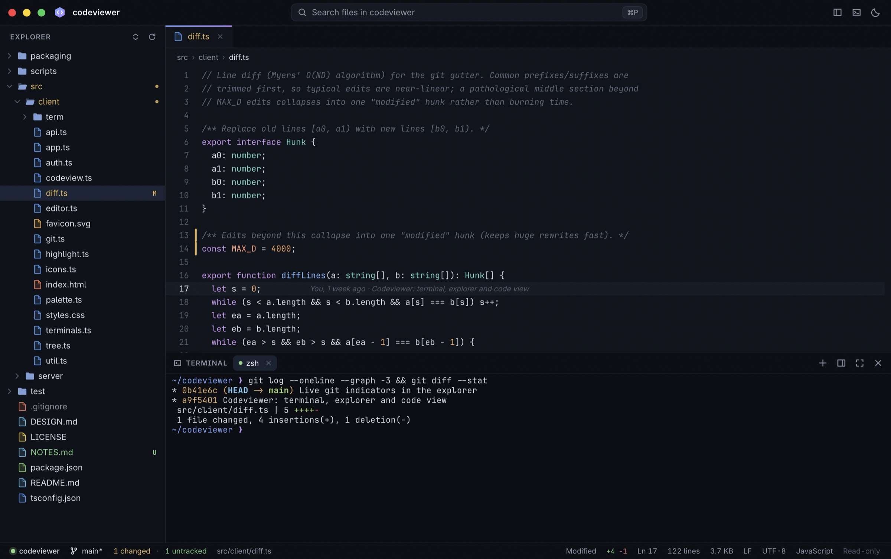

# Codeviewer

**Read the code. Run the agent. Same window.**

A fast, read-only code viewer with a real built-in terminal and live git indicators. It's for
watching your code while an agent (Claude Code, Codex, aider…) or any CLI tool works on it.

**[Download at codeviewer.21no.de](https://codeviewer.21no.de)**: macOS (Apple silicon / Intel),
Linux (x86-64 / ARM64), or a single command-line binary. Every download comes with a SHA-256 and
signed build provenance; see [how to verify](https://codeviewer.21no.de/#verify).



- **Zero dependencies.** Bun + TypeScript only: the terminal emulator, syntax highlighter,
  fuzzy finder, file watcher and UI are all written from scratch.
- **Standalone app.** On macOS it's a native app (AppKit + the system WebKit), installed from a
  40 MB `.dmg`, with no browser bundled. On Linux it bundles a verified
  [ungoogled-chromium](https://github.com/ungoogled-software). Either way, the window is locked down to its own
  loopback server and keeps no browser state.
- **Typography:** JetBrains Mono for code and terminal, Inter for the UI, both embedded (OFL).
  Sizes adapt to pixel density: 13px on HiDPI screens, 14px on 1× screens.
- **Real terminal:** a native PTY (`Bun.spawn({ terminal })`) plus a canvas-rendered xterm-compatible
  emulator with 256/truecolor, the alternate screen, mouse (SGR), bracketed paste, OSC 8 links,
  OSC 52 clipboard, synchronized output, wide characters and emoji, and pixel-exact box
  drawing. Sessions survive page reloads.
- **Search in files:** ⌘⇧F opens a sidebar search over the whole project: literal, whole-word or
  regex, case toggle, include/exclude globs, and `.gitignore` respected unless you opt in to ignored
  files. Results stream in grouped by file, open at the exact match, and offer a Refresh when files
  change on disk. Right-click a folder in the Explorer and pick "Search in Folder…" to scope the
  search to it.
- **Git (read-only):**
  - Explorer status letters and colors (M A U D R C), with folders rolled up and ignored files dimmed.
  - Colored tabs.
  - Gutter markers vs `HEAD`; click one to peek at the old lines.
  - Inline blame on the active line.
  - Status bar: branch, ahead/behind, merge/rebase state, stash count, and change counts.
  - **Review changes (⌘⇧G):** a Changes view in the sidebar lists every file the branch touched
    (vs its base branch, working tree included) or only the uncommitted ones (vs `HEAD`), with
    `+/−` per file and a one-line summary. Each file opens as a read-only unified diff; ⌥F5 walks
    the changes and moves on to the next file. Reviewed files dim until they change again.
    Right-click a file in the Explorer and pick "View Changes" to jump to its diff.
  - Everything updates live as files, the index or refs change.
- **Built-in updates:** "Check for Updates…" (command palette, or the Mac app menu), and an
  update pill in the status bar when a new version is out. Installing verifies the release's
  Ed25519 signature and the file's SHA-256 before an atomic swap, then restarts. Turn off the
  launch-time check with "Toggle Automatic Update Checks" or `CODEVIEWER_NO_UPDATE_CHECK=1`.
- **Live:** files that change on disk reload in place, the changed lines flash, the gutter marks
  them, and the explorer shows dots on changed files.
- **Private:** no telemetry, crash reporting, account or cloud. The only outbound connection is the
  launch-time update check against GitHub's releases API, and it can be switched off (see
  [Privacy](#privacy)).
- **Keyboard and screen-reader friendly:** ⌘/ lists every shortcut in your platform's key names.
  Explorer, search results, Changes and the palette expose their selection to assistive tech, the
  terminal mirrors each finished line into a live region, splitters and diff gaps work from the keyboard,
  and the UI chrome scales with the font size.
- **Fast:** a virtualized code view and tree, an incremental highlighter, and dirty-row
  terminal rendering. A 100k-line file opens instantly.

See [DESIGN.md](DESIGN.md) for the expert-panel design review and the architecture, and
[AGENTS.md](AGENTS.md) if you (or your agent) want to work on the code.

## Install

| Platform | Download | Contents |
| --- | --- | --- |
| macOS | `Codeviewer-<v>-macos-{arm64,x64}.dmg` | Drag `Codeviewer.app` to Applications |
| Linux | `codeviewer-<v>-linux-{x64,arm64}.tar.gz` | `codeviewer/`, with `install.sh` (adds `~/.local/bin/codeviewer` and a desktop entry) |
| Headless | `dist/bin/codeviewer-*` | Slim single binaries with no browser, for `--no-open` / SSH |

- **macOS:** launch from Finder (it asks for a folder), drop a folder on the Dock icon, or use
  **Codeviewer → Install 'codeviewer' Command…** and run `codeviewer <dir>` from any terminal.
  The app is ad-hoc signed, not notarized, so on first launch of a *downloaded* DMG,
  right-click → Open (or run `xattr -dr com.apple.quarantine /Applications/Codeviewer.app`).
- **Linux:** Chromium's sandbox needs unprivileged user namespaces. Some distros (Ubuntu 24.04+) restrict
  them, and `install.sh` prints the one-time command for the setuid `chrome-sandbox` when that's the case.
  The sandbox is never disabled.

## Use

```sh
codeviewer [dir]            # opens the app window (macOS: Codeviewer.app; Linux: bundled Chromium)
codeviewer . --no-open      # headless/SSH: just print the URL
codeviewer open src/app.ts:42   # from inside a codeviewer terminal: show a file in the viewer
```

Options: `--port N`, `--host ADDR` (default `127.0.0.1`), `--shell PATH`, `--browser` (use your default browser).
Closing the app window quits codeviewer. Settings live in `~/.config/codeviewer/settings.json`
(on macOS, `~/Library/Application Support/codeviewer`).

| Keys | Action |
| --- | --- |
| ⌘P / Ctrl+P | Go to file (`path:line` works) |
| ⌘⇧P / Ctrl+Shift+P | Command palette |
| ⌃\` | Toggle / focus terminal · ⌃⇧\` new terminal |
| ⌘F · ⌃G | Find in file · go to line |
| ⌘⇧F / Ctrl+Shift+F | Search in files |
| F4 / ⇧F4 | Next / previous search result |
| ⌘B · ⌘⇧E | Toggle sidebar · focus explorer |
| ⌘W · ⌘⇧[ ⌘⇧] | Close tab · switch tabs (in the terminal: switch terminals) |
| ⌘W in the terminal | Close an exited terminal; a running one asks for a second press (Linux: Ctrl+W stays the shell's) |
| Shift+F10 / Menu | Context menu for the selected explorer entry ("Search in Folder…", "View Changes") |
| ⌘= ⌘- ⌘0 | Font size (code, terminal and the UI chrome) |
| ⌘⇧G · ⌥F5 / ⌥⇧F5 | Changes · next / previous change (then next file) |
| ⌘/ | Every shortcut and the terminal tips, in your platform's key names |
| ⌘-click in terminal | Open `path:line` or URL |
| Left ⌥ | Meta in the terminal (right ⌥ still types special characters) |

## Selection and copy

Select code in the viewer as you would in any editor, dragging in either direction. Copy (Cmd/Ctrl+C or the context menu) puts the exact text on the clipboard, including parts scrolled out of view, and never includes line numbers, the blame label or the truncation label on very long lines. Cmd/Ctrl+A selects the whole file while focus is in the code view, and in a Markdown preview it selects the rendered document (never the sidebar, tabs or status bar). The blame label stays out of the way while you drag or have text selected.

## Markdown

`.md` and `.markdown` files open as a rendered document; the **View source** button (or the command
palette entry **Toggle Markdown Preview**) switches to the highlighted source and back. Opening a file at a
line, Find and Go to line always use the source. The preview updates live when the file changes.

- **Supported:** CommonMark core plus GFM tables, task lists, strikethrough, bare-URL autolinks and
  highlighted fenced code. The parser and renderer are written in this repository, with no dependencies.
- **Untrusted content:** the preview is built with `createElement`/`textContent` only. There is no raw HTML
  (it is shown as text), links use an allowlist (`http`, `https`, `mailto`, `#fragment`, relative paths), and
  relative links open inside the viewer.
- **Images:** relative images of a type the server serves (png, jpg, gif, webp, avif, bmp, ico, svg) load
  through the authenticated raw endpoint; at most 100 images per render. Remote images (`http(s)`, `//host`,
  `data:`) are never loaded: a placeholder shows the alt text and host, with a link to open it in your browser.
- **Limits:** files over 1 MiB open in source with a "Too large to preview · Render anyway" note; nesting,
  table width, line length and about 200,000 rendered nodes are capped and degrade to literal text.

## Security

The server binds to localhost and serves a shell. It was hardened through an adversarial review
(DESIGN.md §11):

- **Access:**
  - A random 256-bit token travels only in the URL *fragment*, then in a request header.
  - There are no cookies (they leak across localhost ports).
  - `Host` is validated (no DNS rebinding), WebSockets require a matching `Origin`, and writes must be JSON.
- **No secrets in process arguments:** browsers start through a private bootstrap page.
- **Files:** every path is `realpath`-contained in the root, and files are opened with
  `O_NOFOLLOW|O_NONBLOCK` (regular files only). Nothing writes to the viewed tree.
- **Git runs untrusted repositories safely:**
  - No filters, textconv, diff drivers, signature checks, fsmonitor or submodule recursion.
  - It never writes the index.
- **App windows:**
  - A throwaway profile, locked to the window's own server port.
  - External links open in your default browser.
  - Terminal clipboard writes always show a notice.
- **Markdown:** repository files are untrusted. The preview never uses `innerHTML`, shows no raw HTML,
  filters link schemes and loads no remote images (the CSP is unchanged).
- **Terminals:** the shell gets a narrow token that only lets `codeviewer open` ask the viewer to show
  a file; the session token never enters a process environment.
- **Updates:** downloads are accepted from GitHub over https only, `SHA256SUMS` must carry a valid
  Ed25519 signature from the release key, sizes are capped, and every file's SHA-256 is checked
  before an atomic swap.
- **Builds:** the Linux browser is pinned by SHA-256 in `packaging/browser-pins.json`.

## Privacy

Codeviewer is a local server on `127.0.0.1` plus a window that can only talk to it. Nothing you view,
type or run is sent anywhere: there is no telemetry, crash reporting, account or cloud component, and
the app window keeps no browser history, cookies or cache. The single outbound request is the
launch-time check of GitHub's releases API for a newer version; turn it off with
"Toggle Automatic Update Checks" in the command palette or `CODEVIEWER_NO_UPDATE_CHECK=1`, after which
the app never opens a socket to the internet. Settings are one JSON file in your profile
(`~/.config/codeviewer/settings.json`; on macOS `~/Library/Application Support/codeviewer`).

## Verify a download

Releases are built by [GitHub Actions](.github/workflows/release.yml) from a version tag, on a
clean runner. Each release has `SHA256SUMS` and a Sigstore-signed provenance attestation:

```sh
shasum -a 256 -c SHA256SUMS --ignore-missing          # Linux: sha256sum -c …
gh attestation verify <file> --repo BackendStack21/codeviewer
```

## Develop

```sh
bun run dev           # build the client and serve the current directory
bun run test          # builds the client, then the whole suite (run one suite at a time; see AGENTS.md)
bun run build         # slim binaries (dist/bin) + .dmg / .tar.gz for every target (dist/release)
bun run build:local   # this machine only: dist/bin/codeviewer + its app (on a Mac: the .dmg)
bun scripts/build.ts --slim             # binaries only, no browser download
bun scripts/build.ts --browser <tag|latest>  # re-pin the Linux browser (packaging/browser-pins.json)
bun run site          # regenerate docs/index.html (the landing page; release data loads live from GitHub)
```

### Release signing (once)

The in-app updater only installs releases whose `SHA256SUMS` is signed by the release key.
Create it once with `bun scripts/release-key.ts`: the private key goes straight into the
`CODEVIEWER_UPDATE_KEY` Actions secret (never to disk), and `packaging/update-key.pub` is
updated. Commit that file. Releases fail until the key exists.

### Releasing

1. Bump `version` in `package.json` and commit.
2. `git tag v<version> && git push --tags`
3. The release workflow runs the tests, builds every package, signs `SHA256SUMS`, attests
   provenance and publishes the GitHub release. The landing page picks it up by itself: it
   reads the latest release (names, sizes, SHA-256) from GitHub's API in the browser.

The landing page is `docs/`, served as static assets by **Cloudflare Workers** at
`codeviewer.21no.de` (config in `wrangler.jsonc`; headers in `docs/_headers`). In the Cloudflare
build settings, leave the **build command empty**: `docs/` is committed, and `npm run build` would
build every release binary for nothing. The deploy command is `npx wrangler deploy`.

## License

[MIT](LICENSE) © 2026 [21no.de](https://21no.de). Bundled fonts: JetBrains Mono and Inter in the app,
Space Grotesk on the website (all SIL OFL 1.1, see `vendor/fonts`). The Linux packages bundle ungoogled-chromium (BSD-3-Clause and others).
